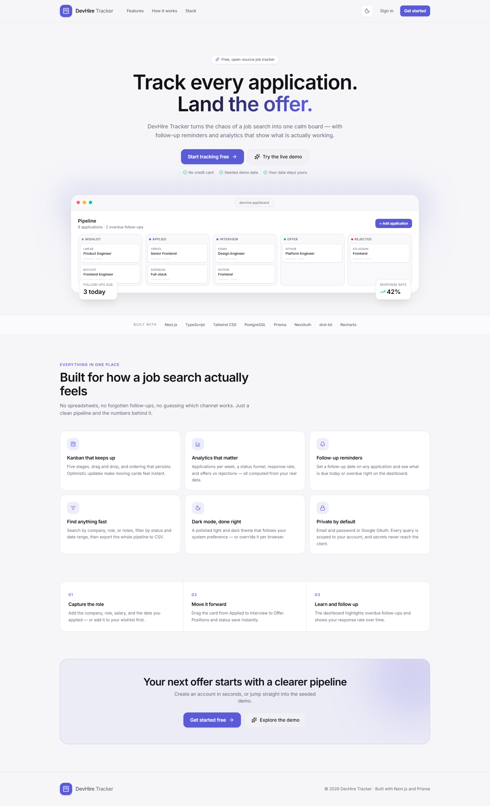
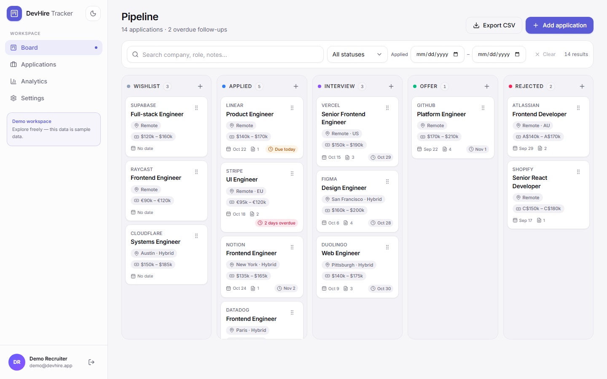
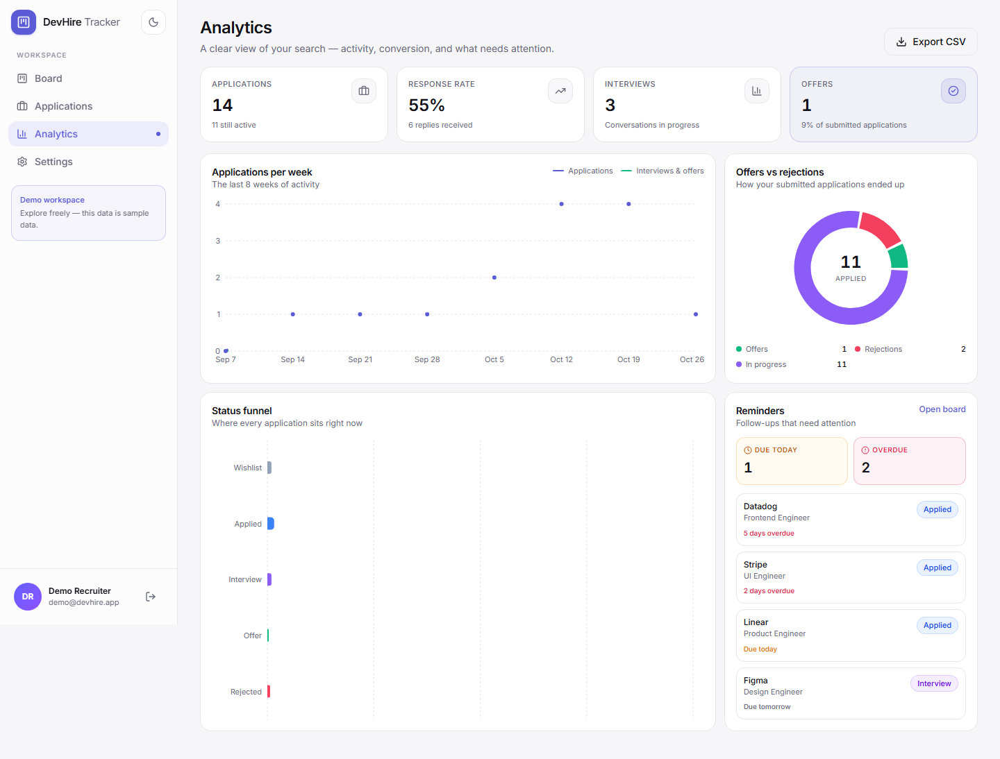
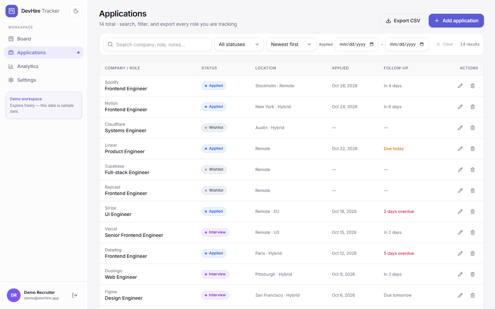
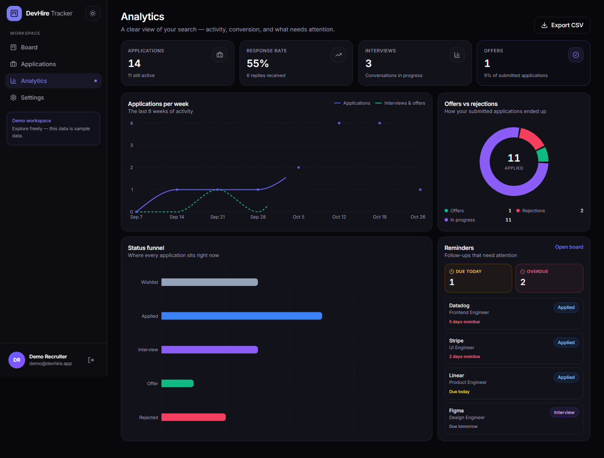
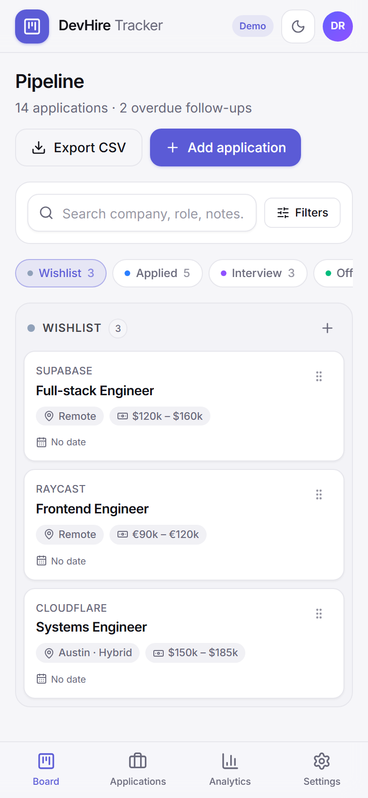

# DevHire Tracker

A full-stack job application tracker with a drag-and-drop Kanban pipeline, a follow-up workflow, and an analytics dashboard. Built with the Next.js App Router, PostgreSQL, and Prisma.

[](https://github.com/zee5256/devhire-tracker/actions/workflows/ci.yml)



> **Try it:** run the app locally and sign in with `demo@devhire.app` / `demo1234`, or click **Explore the demo workspace** on the login screen. The demo account is seeded with 14 realistic applications, notes, and follow-up dates.

---

## Overview

Job hunting generates a spreadsheet's worth of state: which roles you applied to, when to follow up, what stage each conversation is in, and whether the whole effort is working. DevHire Tracker puts that state on a single board and pairs it with the numbers that tell you where to spend your time.

The project is a complete, production-shaped application rather than a UI mockup: real authentication, per-user data isolation, validated API routes, optimistic drag-and-drop with persisted ordering, a seeded demo account, and an end-to-end test that exercises the core flow.

## Features

**Authentication**

- Email + password sign-up and sign-in with bcrypt password hashing.
- Optional Google OAuth — the provider is only registered when its credentials are configured.
- Protected app routes and ownership checks on every API query.
- One-click demo login, plus a seeded demo workspace.

**Pipeline**

- Five-stage Kanban board: Wishlist → Applied → Interview → Offer → Rejected.
- Drag and drop between and within columns (pointer, touch, and keyboard sensors).
- Optimistic updates with automatic rollback if the reorder request fails.
- Create, edit, and delete applications through a validated modal (React Hook Form + Zod).
- Detail drawer with application metadata, a note timeline, and add-note composer.
- Application table with search, status/date filters, and sorting.
- CSV export of the current pipeline.
- Overdue and due-today follow-up reminders on the dashboard.

**Analytics**

- Applications per week (8-week trend, applications vs. interviews/offers).
- Pipeline funnel by stage.
- Response rate and offer rate.
- Offers vs. rejections donut with in-progress applications.
- Empty states and loading skeletons for every data surface.

**Experience**

- Responsive SaaS layout: fixed sidebar on desktop, bottom navigation on mobile.
- Mobile board columns as swipeable tabs.
- Light and dark themes with system preference support.
- Micro-animations for cards, modals, drawers, and page transitions.
- Accessible controls: keyboard drag handles, focus trapping in dialogs, ARIA labels, and visible focus states.

## Screenshots

| Board | Analytics |
| --- | --- |
|  |  |

| Applications | Dark mode |
| --- | --- |
|  |  |

<p align="center">
  
</p>

## Tech stack

| Layer | Choice |
| --- | --- |
| Framework | Next.js 16 (App Router, Route Handlers, Turbopack) |
| Language | TypeScript |
| UI | React 19, Tailwind CSS v4, Framer Motion, Lucide icons |
| Components | Custom, typed primitives (button, fields, modal, drawer, toast) |
| Database | PostgreSQL + Prisma 6 |
| Auth | Auth.js / NextAuth 5 (credentials + Google OAuth, JWT sessions) |
| Drag and drop | dnd-kit (`core`, `sortable`) |
| Forms | React Hook Form + Zod |
| Charts | Recharts |
| Notifications | Sonner |
| Tests | Playwright |

## Project structure

```text
app/
  (app)/                 Authenticated shell: board, applications, analytics, settings
  (auth)/                Login and register pages
  api/                   Route handlers: applications, notes, reorder, export, auth
components/
  applications/          Board client, table, filters, card, drawer, form modal
  board/                 DnD context, columns, sortable cards
  analytics/             Recharts line, funnel, and donut components
  layout/                Sidebar, mobile chrome, sign-out
  ui/                    Reusable primitives and skeletons
hooks/                   Applications provider, filters, mounted helper
lib/                     Auth config, Prisma client, analytics, CSV, validations
prisma/                  Schema, migration, idempotent seed script
tests/e2e/               Playwright happy-path test
docs/screenshots/        README images
```

## Getting started

### Prerequisites

- Node.js 20.9+ (Node 22+ recommended)
- PostgreSQL 14+ running locally, or a hosted database such as Neon or Supabase

### 1. Install dependencies

```bash
npm install
```

`postinstall` runs `prisma generate`. If your environment blocks install scripts, run `npm run db:generate` manually.

### 2. Configure environment variables

```bash
cp .env.example .env
```

Then set `DATABASE_URL`, `DIRECT_URL`, and `AUTH_SECRET`. Locally, `DIRECT_URL` can be identical to `DATABASE_URL`; on a pooled host such as Neon it must be the direct (unpooled) connection string so migrations can run. Generate a secret with:

```bash
npx auth secret
# or: openssl rand -base64 32
```

### 3. Create the schema and seed data

```bash
npx prisma migrate dev
npm run db:seed
```

The seed is idempotent: it creates the demo user if needed, refreshes only that user's applications and notes, and leaves other accounts untouched.

### 4. Run the app

```bash
npm run dev
```

Open <http://localhost:3000>. Sign in with the demo account or create your own.

**Demo credentials:** `demo@devhire.app` / `demo1234`

## Environment variables

| Variable | Required | Description |
| --- | --- | --- |
| `DATABASE_URL` | Yes | PostgreSQL connection string used at runtime. Add `?sslmode=require` for hosted providers; on Neon use the pooled connection string. |
| `DIRECT_URL` | Yes | Direct (unpooled) PostgreSQL connection string used by Prisma migrations. Set it to the same value as `DATABASE_URL` locally. |
| `AUTH_SECRET` | Yes | Secret used to sign JWT sessions. |
| `AUTH_URL` | Production | Public base URL used by Auth.js (for example `https://your-app.vercel.app`). |
| `GOOGLE_CLIENT_ID` | No | Google OAuth client ID. Google sign-in appears only when both Google values are set. |
| `GOOGLE_CLIENT_SECRET` | No | Google OAuth client secret. |
| `NEXT_PUBLIC_DEMO_EMAIL` | No | Demo account email shown on the login screen and used by the seed. |
| `NEXT_PUBLIC_DEMO_PASSWORD` | No | Demo account password used by the seed. |

For Google OAuth, add the authorized redirect URI:

```text
http://localhost:3000/api/auth/callback/google
https://your-domain.com/api/auth/callback/google
```

## Data model

```text
User (id, name, email, passwordHash?, image?, createdAt)
 └── Application (id, userId, company, role, jobUrl?, location?, salary?,
                  status, appliedDate?, followUpDate?, notes?, position,
                  createdAt, updatedAt)
      └── Note (id, applicationId, content, createdAt)
```

- `ApplicationStatus` is a Postgres enum: `WISHLIST | APPLIED | INTERVIEW | OFFER | REJECTED`.
- `position` gives each card a stable order inside its column.
- Reads are indexed on `(userId, status, position)`, `(userId, updatedAt)`, and `(userId, followUpDate)`.
- Dates are stored as `DATE` columns and handled as UTC calendar dates end to end.

Auth.js adapter tables (`Account`, `Session`, `VerificationToken`) live in the same schema.

## Scripts

| Command | Description |
| --- | --- |
| `npm run dev` | Start the development server. |
| `npm run build` | Production build. |
| `npm run start` | Serve the production build. |
| `npm run lint` | ESLint. |
| `npm run typecheck` | TypeScript, no emit. |
| `npm run db:generate` | Generate the Prisma client. |
| `npm run db:migrate` | Create/apply a development migration. |
| `npm run db:push` | Push the schema without a migration (prototyping). |
| `npm run db:seed` | Seed the demo workspace. |
| `npm run db:studio` | Open Prisma Studio. |
| `npm run test:e2e` | Run the Playwright suite. |

## Testing

The end-to-end test covers the core product loop:

1. Register a new account.
2. Add an application through the form modal.
3. Drag the card from Wishlist to Interview and wait for the persist request.
4. Reload and confirm the new stage survived.
5. Sign out, sign back in, and confirm the board is restored.

```bash
npx playwright install chromium
npm run test:e2e
```

Playwright starts `npm run dev` automatically when no server is running, and reuses an existing one on port 3000. The test creates its own user, so it does not depend on the demo seed. Point it at another environment with `PLAYWRIGHT_BASE_URL`.

## Troubleshooting

**Sign-up fails with “Something went wrong.” on a local database**

On Windows, a locally initialised PostgreSQL cluster can default to the `WIN1252` encoding. Latin names work, but Arabic, Persian, CJK, or emoji characters fail on insert with PostgreSQL error `22P05`, which surfaces as a generic 500 from the API.

Check the database encoding:

```sql
SELECT pg_encoding_to_char(encoding) FROM pg_database WHERE datname = 'devhire';
```

If it is not `UTF8`, recreate the database (this removes local data) and rebuild it:

```sql
DROP DATABASE devhire;
CREATE DATABASE devhire WITH TEMPLATE template0 ENCODING 'UTF8' LC_COLLATE 'C' LC_CTYPE 'C';
```

```bash
npx prisma migrate deploy
npm run db:seed
```

Hosted providers such as Neon and Supabase create databases as UTF-8 by default, so this only affects some local clusters.

## Deployment

### Vercel + Neon (free tier friendly)

The repository includes a `vercel-build` script (`prisma migrate deploy && next build`), so every deployment applies pending migrations before building.

1. **Create a database.** Create a Neon project and copy both connection strings:
   - **Pooled connection** → `DATABASE_URL` (used by the app at runtime)
   - **Direct connection** → `DIRECT_URL` (used by Prisma for migrations)
2. **Import the repository into Vercel.** Vercel detects Next.js and runs `npm run vercel-build` automatically.
3. **Set environment variables** for Production, Preview, and Development: `DATABASE_URL`, `DIRECT_URL`, `AUTH_SECRET`, `AUTH_URL`, and optionally the Google values and demo credentials. Set `AUTH_SECRET` to a fresh random value — do not reuse the development secret.
4. **Deploy.** The build applies migrations, then builds the app.
5. **Seed the demo account** once, from your machine, with the production values loaded:

   ```bash
   npm run db:seed
   ```

   The seed only refreshes the demo user, so it is safe to re-run.
6. **Add the production Google redirect URI** if OAuth is enabled, then redeploy after changing environment variables.

### Notes

- `AUTH_URL` should be the canonical HTTPS origin. Auth.js also derives the URL from Vercel's environment when it is omitted, but setting it explicitly avoids callback mismatches.
- Auth.js sessions are JWTs, so no session table is required for credentials sign-in. The adapter tables remain for OAuth account linking.
- The demo account is public and shared. Reseed it whenever you want a clean state.
- To run migrations outside the Vercel build, point `DIRECT_URL` at the unpooled database and run `npx prisma migrate deploy`.

## Implementation notes

- **Optimistic ordering.** Moving a card updates local state immediately, then sends a single `PATCH /api/applications/reorder` with the affected ids, statuses, and positions. The provider restores the previous snapshot if the request fails.
- **Filters pause drag.** When a search or filter is active, the board becomes read-only for reordering so positions cannot be written against a partial view.
- **Server-side analytics.** Response rate, funnel counts, and weekly buckets are computed from one scoped query and passed to client charts as serialisable data.
- **Route-level auth.** The `(app)` layout checks the session for page loads; API handlers call a shared `requireUserId()` helper and scope every query by `userId`. There is no route that trusts a client-supplied user id.
- **Deterministic dates.** `appliedDate` and `followUpDate` are `@db.Date` values formatted in UTC, avoiding off-by-one-day bugs around time zones.

---

Built as a portfolio project with Next.js, Prisma, and PostgreSQL.
